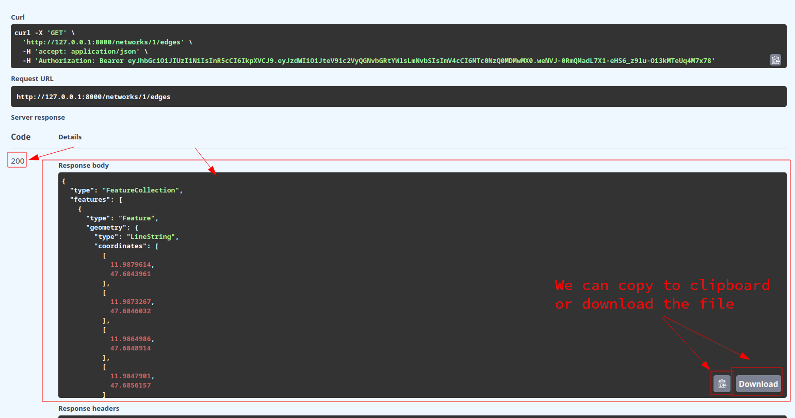

# Road Archiver

[](https://github.com/ValantisChatzimagkas/Road-Archiver/actions/workflows/ci.yml)

A REST API for versioned road networks. Upload a network as GeoJSON, push updates over time without losing history, and query the network as it existed at any point in time.

Live API docs (Swagger UI): <https://valantischatzimagkas.github.io/Road-Archiver/>

## Overview

Road networks change, and downstream consumers often need to know what the network looked like at a specific moment. Road Archiver stores each network as a set of edges (road segments) in PostGIS. Updates never delete anything: replaced edges are marked as superseded and stay queryable.

**Stack:** FastAPI, SQLAlchemy 2.0, GeoAlchemy2, PostgreSQL/PostGIS, Alembic, JWT auth, uv, Docker Compose, pytest.

## Features

- Upload road networks as GeoJSON; each belongs to the user that uploaded it.
- Update a network from a new GeoJSON file. Previous edges are kept, flagged as not current.
- Retrieve a network's edges as GeoJSON, either the current state or the state at a given timestamp.
- JWT authentication (bcrypt-hashed passwords) with role-based access.
- Schema managed by Alembic migrations, applied automatically on container start.
- Integration tests that run against the real API and PostGIS in Docker.

## Architecture

```
app/
  api/v1/endpoints/   HTTP layer: routing, request/response models, auth dependencies
  api/v1/services/    Business logic and database access
  db/models.py        SQLAlchemy / GeoAlchemy2 models
  core/               Settings, DB session, password hashing
alembic/              Schema migrations
```

Requests flow endpoints -> services -> models. Handlers are plain `def` functions, so FastAPI runs them in its threadpool, which suits the blocking SQLAlchemy session.

**Auth.** `POST /auth/login` takes the user's email and password and returns a signed JWT (HS256, 24h expiry). Protected endpoints resolve the current user from the bearer token.

**Versioning model.** A network owns many `road_edges`. Each edge has a `timestamp` (when it was created), an `is_current` flag and a `superseded_at` timestamp (set when an update replaces it). Nothing is ever deleted by an update.

## Getting started

Requires Docker with Compose.

```bash
git clone https://github.com/ValantisChatzimagkas/Road-Archiver.git
cd Road-Archiver
docker compose up --build
```

The stack works with no configuration, using dev-only defaults for the database credentials and JWT secret. To override them, copy `.env.example` to `.env`. Always set your own `JWT_SECRET_KEY` for anything other than local use. Set `API_PORT` to publish the API on a port other than 8000.

The API is then available at <http://localhost:8000>, with interactive docs at <http://localhost:8000/docs>. The database is not published to the host.

## API usage

Sample files are in [`examples/`](examples/).

```bash
API=http://localhost:8000

# Register (the response contains your user id)
curl -X POST $API/users/ -H 'Content-Type: application/json' \
  -d '{"username":"alice","email":"alice@example.com","hashed_password":"s3cret","role":"USER"}'

# Log in (form-encoded; the username field is the email)
TOKEN=$(curl -s -X POST $API/auth/login \
  -d 'username=alice@example.com&password=s3cret' | python3 -c 'import sys,json; print(json.load(sys.stdin)["access_token"])')

# Upload a network
curl -X POST $API/networks/upload -H "Authorization: Bearer $TOKEN" \
  -F 'file=@examples/road_network_bayrischzell_1.0.geojson'

# List your networks to find the network id (replace 1 with your user id)
curl $API/users/1/networks -H "Authorization: Bearer $TOKEN"

# Update network 1 with a newer version of the data
curl -X POST $API/networks/1/update -H "Authorization: Bearer $TOKEN" \
  -F 'file=@examples/road_network_bayrischzell_1.1.geojson'

# Current state
curl $API/networks/1/edges -H "Authorization: Bearer $TOKEN"

# State as of a timestamp (ISO 8601, UTC)
curl -G $API/networks/1/edges -H "Authorization: Bearer $TOKEN" \
  --data-urlencode 'timestamp=2025-01-01T12:00:00Z'
```

The edges endpoint returns a GeoJSON `FeatureCollection`:



## Running tests

```bash
uv sync
uv run pytest -q
```

The suite uses `pytest-docker` to build and start the API and a PostGIS database from `tests/docker-compose.test.yml` (it publishes the API on host port 8000, so that port must be free), then exercises the HTTP API end to end. The first run takes a few minutes while the image builds.

Lint with `uvx ruff@0.17.6 check .`.

## Design decisions

**Why PostGIS.** Edges are geometries. PostGIS stores them natively (`geometry(GEOMETRY, 4326)`) with a GiST spatial index, so the data is ready for spatial queries (bounding box, intersection, distance) without a data migration. Geometry is converted to and from GeoJSON with Shapely.

**Edge versioning and point-in-time queries.** An update marks every current edge of the network as `is_current = false` and sets its `superseded_at`, then inserts the new file's features as new current edges, all with the same timestamp, in one transaction. Querying without a timestamp returns edges where `is_current` is true. Querying with a timestamp `T` returns edges where `timestamp <= T` and (`superseded_at` is null or `superseded_at > T`), i.e. the edges that were live at `T`.

**Role-based access.** Roles are `ADMIN`, `MODERATOR`, `USER` and `GUEST`. Today only `ADMIN` is treated differently: admins can read any user or network and delete users. Everyone else can only access their own data. Accessing another user's network returns 404 rather than 401/403, so network ids are not disclosed.

**Migrations.** Alembic is the only source of schema truth. The API container runs `alembic upgrade head` before starting, and the initial migration enables the `postgis` extension. If you have a database created by an earlier version of this project (via `create_all`), it lacks the `superseded_at` column; recreate it, or add the column manually and run `alembic stamp head`.

## Limitations and roadmap

Known limitations:

- Self-registration accepts any role, including `ADMIN`. This is a demo convenience and must be restricted before any real deployment.
- An update replaces the whole network. Edges are not diffed, so unchanged edges are also re-inserted as new versions.
- The edges endpoint returns geometry plus `id`, `timestamp` and `is_current`; the original road attributes (name, lanes, and so on) are stored but not returned.
- The upload response does not include the new network id; use `GET /users/{id}/networks`.
- No pagination, and no spatial filtering on retrieval.
- `MODERATOR` and `GUEST` roles exist but carry no extra permissions.
- The test suite shares one database and relies on sequential ids.

Roadmap:

- Return edge attributes and the new network id from upload.
- Bounding-box filtering and pagination on the edges endpoint.
- Diff-based updates that only version changed edges.
- Admin-only role assignment.

## License

[MIT](LICENSE)
